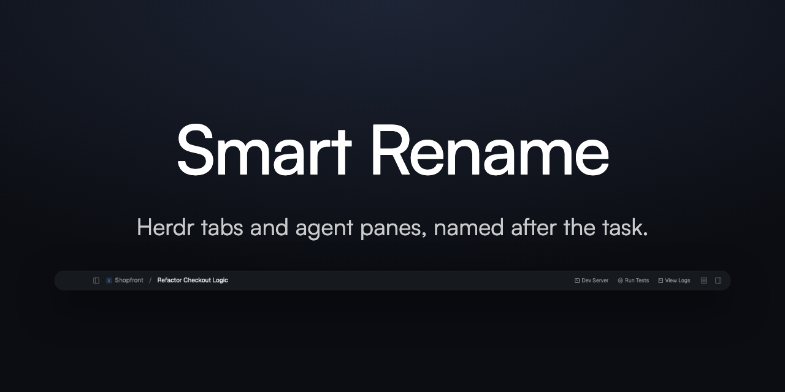
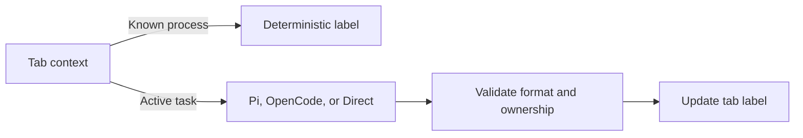

# Smart Rename



Name Herdr tabs automatically from the task running inside them.

https://github.com/user-attachments/assets/e8270d60-275b-42af-8754-73cd50b11cb4

Jump between a code review, a failing test run, and a remote shell without guessing which tab holds what. Smart Rename reads the active task, picks a short English label, and leaves names you set yourself alone.

- Use Pi, OpenCode, or a Direct OpenAI-compatible API, with an optional fallback provider for Direct requests.
- Name local tabs and tabs on remote machines connected to your core from one install.
- Keep manual tab names untouched until you press `ctrl-shift-r` or run an explicit rename.
- Name common processes locally (`Run Tests`, `Dev Server`, `View Logs`, `Remote Shell`) and wait for a real prompt before naming new Pi or Claude Code sessions.

## Install on macOS

Use the native service for the Herdr app (`herdr-app`) and Herdr Core (`hc`) on macOS. For the legacy `herdr` daemon or Windows, see [legacy daemon and Windows](#legacy-daemon-and-windows).

The Herdr app and the Sheprd companion can both be named `Herdr.app`. Confirm the executables are on `PATH`:

```sh
herdr-app --version
hc --version
```

You need Bun 1.2.23 or newer, and the Herdr app must be open before you install. If `herdr-app` or `hc` is not on `PATH`, set absolute `HERDR_APP_BIN_PATH` and `HC_BIN_PATH`. The installer does not install Bun, `herdr-app`, or `hc`.

Download the installer and checksum manifest, verify `install.sh`, then run it:

```sh
curl --proto '=https' --tlsv1.2 -fsSLO https://github.com/iurysza/herdr-tab-smart-rename/releases/latest/download/install.sh
curl --proto '=https' --tlsv1.2 -fsSLO https://github.com/iurysza/herdr-tab-smart-rename/releases/latest/download/SHA256SUMS
grep '  install.sh$' SHA256SUMS | shasum -a 256 -c -
sh install.sh --native
```

The installer checks `smart-rename-native.tar.gz` against its embedded checksum and `SHA256SUMS` before writing files. It installs `~/.local/bin/smart-rename-native`, registers a user LaunchAgent, and adds the in-app `ctrl-shift-r` trigger. It waits up to 180 seconds for the worker to list tabs and connect to core events; if startup fails, it stops and restores the previous activation.

If native configuration is missing or invalid, setup copies existing `model-selection.json`, `naming-prompt.md`, and `provider.env` from the daemon config directory without changing the originals. A valid imported selection skips the model wizard; otherwise setup asks you to choose a model. Add `~/.local/bin` to `PATH` if needed.

See [native macOS app](./docs/install.md#native-macos-app) for `--config-dir`, local checkout installs (`sh installer/install.sh --native`), and default file locations.

## Name your first tab

Check that the background service is running:

```sh
smart-rename-native status
```

`status` reports launchd process state, worker health, target counts, and any offline or blocked remote targets.

Open a tab in the Herdr app and start a task, such as a test run or an agent prompt. Background naming updates the tab label automatically once it has clear task context, and it leaves any name you typed yourself alone.

To name the focused local or remote tab immediately, press `ctrl-shift-r`. The shortcut replaces a name you set yourself and shows the result in a toast. If `ctrl-shift-r` is already bound to another command, install leaves your binding untouched and reports `colliding`; bind `mod.open:smart-rename` to a free key.

To remove the service later:

```sh
smart-rename-native uninstall
```

`uninstall` removes the service, the owned in-app mod, and the `ctrl-shift-r` binding. It keeps your configuration, naming state, and versioned source.

To name one tab by ID from a local checkout (such as `tb1a` or `workstation/tb1a`), see [name one tab](./docs/install.md#name-one-tab).

## How naming works



Smart Rename names tabs with 2–4 Title Case English words under 30 characters and abstains rather than guessing. Automatic model naming for Pi and Claude Code sessions waits for a readable user request so startup banners do not produce noisy labels. Background model attempts wait 10 minutes per target, with a 60-second sweep for silent task changes. Explicit renames bypass cooldowns.

Install Smart Rename only on the computer that runs the Herdr app. Model configuration stays on that machine, and each model request sends the tab's bounded context (capped at 4,500 serialized characters, without environment variables) to your selected provider. Smart Rename redacts common secret patterns and the local home path best-effort, but redaction can miss secrets, and a manual name protects the label rather than its pane content. Read [private files and context](./docs/configuration.md#private-files-and-context) before naming tabs that hold sensitive text.

## Models and configuration

Smart Rename supports three model sources:

- **Pi**: uses Pi's connected providers and `models.json` definitions without running a Pi agent, tools, or extensions.
- **OpenCode**: uses providers connected in the installed OpenCode executable with temporary sessions and tool execution denied.
- **Direct**: calls an OpenAI-compatible API configured in `provider.env`, with built-in defaults for `openai` and `deepseek` and support for custom endpoints.

Direct requests can retry once with an optional fallback provider when the primary request fails, times out, or returns an invalid label. Set `SMART_RENAME_FALLBACK_BASE_URL`, `SMART_RENAME_FALLBACK_MODEL`, and `SMART_RENAME_FALLBACK_API_KEY` together (and optionally `SMART_RENAME_FALLBACK_REASONING_EFFORT`) in `provider.env` or the environment. See [Direct fallback](./docs/configuration.md#direct-fallback).

To customize naming instructions, edit `naming-prompt.md` in your config directory (`~/.config/herdr-tab-smart-rename/native` by default for the native service, or `herdr plugin config-dir tab-smart-rename` for the daemon) or point `SMART_RENAME_PROMPT_PATH` at another file.

## Legacy daemon and Windows

The legacy `herdr` daemon plugin does not name Herdr app tabs. It requires Herdr 0.7.5 or newer and Bun 1.2.23 or newer.

On macOS and Linux, download and verify `install.sh` against `SHA256SUMS` as above, then run it from a Herdr terminal without `--native`:

```sh
sh install.sh
```

Add `--install-only --yes` to install without opening interactive setup.

On Windows (also works on macOS and Linux), with Bun on Herdr's `PATH`:

```sh
herdr plugin install iurysza/herdr-tab-smart-rename
herdr plugin action invoke setup --plugin tab-smart-rename
```

See [installation](./docs/install.md) for upgrades, moving from a local checkout, and switching providers, and [configuration](./docs/configuration.md) for daemon actions and keybindings.

## Troubleshoot

| Problem | What to do |
| --- | --- |
| Install rolls back | Open the Herdr app, confirm `herdr-app` and `hc` run, then install again. |
| `ctrl-shift-r` does nothing | Run `smart-rename-native status`. If install reported `colliding`, bind `mod.open:smart-rename` to a free key. |
| A name you set stays | Press `ctrl-shift-r` (or run `rename-now` in the daemon). Background naming keeps manual names. |
| A remote tab stays unnamed | Connect that machine to this core. A changed core alias stays blocked until the native service restarts. Check `smart-rename-native status` for blocked targets. |
| The daemon worker is stopped | See [troubleshooting](./docs/configuration.md#troubleshooting). |

## Documentation

- [Installation](./docs/install.md): native macOS service, one-tab CLI, legacy daemon, Windows, and upgrades.
- [Configuration and controls](./docs/configuration.md): model sources, Direct settings, fallback provider, daemon actions, shortcuts, and privacy.
- [Naming policy](./docs/naming-policy.md): default model prompt, label rules, ownership, and retry behavior.
- [Development](./docs/development.md): contained test runner, live Herdr checks, and pre-commit checks.
- [Releasing](./docs/releasing.md) and [changelog](./CHANGELOG.md).

## Development

Smart Rename runs TypeScript directly with Bun 1.2.23 or newer. Install dependencies and run the local checks:

```sh
bun install --frozen-lockfile
bun run check
bun run lint
bun test
```

On macOS, run `bun scripts/test-contained.ts` to isolate tests from your home directory and network. `src/` holds the native service, daemon worker, context collectors, and model providers; `installer/` holds the release installer; `docs/naming-policy.md` is both documentation and the runtime's default system prompt.
