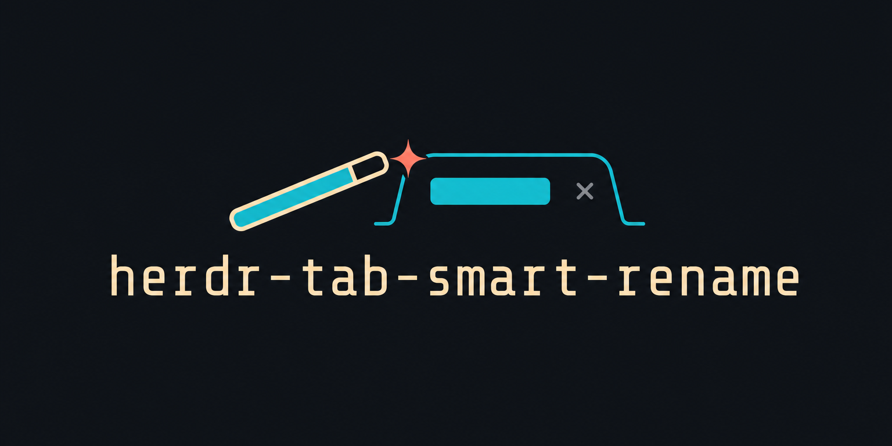

# Smart Rename



Name your Herdr tabs and agent panes after their current task.

An agent reviewing authentication can show `Review Auth Changes`. A test run can show `Run Tests`. Smart Rename updates these labels in the background so you can find the right tab without opening it.

- Give agents separate pane labels, even when they share a tab.
- Keep names you set yourself until you explicitly reset or rename them.
- Name known commands without an AI call. Use a model to interpret other tasks.
- Reuse connected Pi or OpenCode providers, or supply an OpenAI-compatible API key.

## Demo


https://github.com/user-attachments/assets/0c9d1ff9-58c5-4b87-a505-74fcb62e29b1


## Use the native herdr app

The native herdr app uses `herdr-app` and `hc`, not the older `herdr` daemon. The native app and the Sheprd companion can both be named `Herdr.app`. Check `herdr-app --version` and `hc --version` rather than inferring the product from its bundle name.

For automatic naming across local and connected remote tabs, use the optional [native macOS service installer](./docs/install.md#native-macos-app). From a local checkout, run `sh installer/install.sh --native`. The release one-liner needs a release containing the native payload; this change does not publish one. The native installer imports existing model selection and naming policy without contacting the daemon.

From a checkout with dependencies installed, find a native tab ID with `herdr-app ls`. Pass that ID explicitly. Local IDs look like `tb…`; remote IDs include their machine prefix, such as `workstation/tb…`.

```sh
bun src/herdr-app-cli.ts rename-now --tab "$TAB_ID" --config-dir "$CONFIG_DIR"
```

`CONFIG_DIR` is your existing Smart Rename private model configuration directory. The native entry point reads that selection and prompt without rewriting them. You can also configure Direct through the documented `SMART_RENAME_*` environment variables.

The native installer also binds `ctrl-shift-r` in the app to name the focused tab now, through a small owned mod; see [the install guide](./docs/install.md#native-macos-app). It skips the key if you already use it.

`rename-now` deliberately reclaims a manual tab name. Use `once` to preserve manual names, or `dry-run` to preview eligible changes without writing labels or state. `watch` runs in the foreground until Ctrl+C and preserves manual names:

```sh
bun src/herdr-app-cli.ts watch --tab "$TAB_ID" --config-dir "$CONFIG_DIR"
```

The native backend changes only the selected tab, locally or on an already-connected remote machine. Keep the full machine prefix for remote targets. Other tabs, space names, pane titles and the daemon worker stay unchanged.

The naming process and provider configuration stay on this computer. Remote targets use the local core's existing connection, not a second Smart Rename installation. A model request sends the selected tab's bounded context to your configured provider. The foreground commands do not install or copy daemon transcripts, remote credentials, a background service or a layout mod.

Remote state and locks use the target core's permanent identity. For remote targets, `--state-dir` selects a base directory containing a private `remote/<hash>` subdirectory. Offline targets keep their ownership state; `watch` retries through the existing event subscription and recovery sweep. An alias pointing to a different core requires a restart.

See [native-app architecture and limits](./ai-artifacts/architecture/native-herdr-app.md) for ownership, state isolation and the remaining manual-edit race.

## Install the daemon plugin on macOS or Linux

You need Herdr 0.7.5+ and Bun 1.2.23+ installed. Pi and OpenCode are optional.

Run this from a Herdr terminal:

```sh
curl -fsSL https://github.com/iurysza/herdr-tab-smart-rename/releases/latest/download/install.sh | sh
```

The installer installs the plugin and opens setup. Choose a model, confirm, and background naming starts.

For Windows, use the [Herdr installation commands](./docs/install.md#windows). For an existing installation, follow the [upgrade guide](./docs/install.md#upgrade-an-existing-install) or [local-checkout migration](./docs/install.md#move-from-a-local-checkout).

## Choose a model

The setup wizard lets you choose a model:


Setup offers three sources:

- Direct uses an OpenAI-compatible endpoint, model ID, and API key. Neither Pi nor OpenCode needs to be installed.
- Pi reuses a provider you have connected in Pi, with its models and supported thinking levels.
- OpenCode reuses a provider you have connected in an installed OpenCode, with its models and variants.

To change the model later, reopen setup:

```sh
herdr plugin action invoke setup --plugin tab-smart-rename
```

## Rename your current tab

After setup, use your terminal as usual. Known commands get names such as `Run Tests` or `Dev Server`. For other tasks, Smart Rename asks your selected model for a short label.

To request a name now:

```sh
herdr plugin action invoke rename-now --plugin tab-smart-rename
```

This action can replace a name you set yourself. It affects only the current tab, leaving pane and workspace labels alone. A notification reports the result or explains why the tab was not renamed.

To check or stop background naming:

```sh
herdr plugin action invoke status --plugin tab-smart-rename
herdr plugin action invoke stop --plugin tab-smart-rename
```

Use `start` to resume it. See [actions and shortcuts](./docs/configuration.md) for pane resets, all-tab renames, and keyboard bindings.

## How naming works

Smart Rename uses the focused agent's task to name a shared tab, or another active pane when needed. Supporting servers and logs do not replace an active agent's task. Each recognized agent pane gets its own label.

Background naming preserves manual labels. Weak evidence leaves a name unchanged, and results from closed panes or changed agent sessions are discarded.

Model-backed naming sends bounded terminal context to your selected provider. Pi and Claude Code panes can also contribute short user-request excerpts. Secret redaction is best-effort, and a manual name does not exclude its pane's content. Read [privacy and context](./docs/configuration.md#private-files-and-context) before using it with sensitive work.

## Documentation

- [Installation](./docs/install.md): platforms, upgrades, and migration from a local checkout.
- [Configuration and controls](./docs/configuration.md): actions, shortcuts, model sources, and troubleshooting.
- [Naming policy](./docs/naming-policy.md): the default instructions used to generate labels.
- [Knowledge base](./ai-artifacts/README.md): architecture diagrams, naming glossary, runtime flows, and a code and test map.
- [Release process](./docs/releasing.md) and [changelog](./CHANGELOG.md).

## Development

Smart Rename runs TypeScript directly with Bun. There is no build step.

```sh
bun install --frozen-lockfile
bun run check
bun run lint
```

On macOS, run tests with the contained runner to keep them away from your real credentials and Herdr sessions:

```sh
bun scripts/test-contained.ts
```

The naming service lives in `src/service.ts`, with model adapters in `src/model-sources/`. See [development](./docs/development.md) for other platforms, integration tests, and linking a checkout to Herdr.
