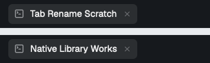

# Remote native-app verification

Verified on 7 November 2026, extending the local-only checkpoint at `c9ad49f` on `feat/herdr-app`.

## Result

The actual native CLI renames an owned tab on the already-connected `work-herdr` machine. The watcher also names that tab after real remote events. Naming and provider fixtures stay on this computer; no Smart Rename process or credentials are installed remotely.



[Remote receipt](proof.json) records successful naming, three localhost fixture requests, one watcher suggestion, preserved neighbouring names, restored tab and pane selection, and completed scratch-terminal shutdown. [Command results](commands.log) contain the owned test's CLI results. [Protocol receipt](protocol-proof.json) records remote layout routing and an unfiltered broker document notification.

## Gate

| Check | Result |
| --- | --- |
| `bun run check` | Passed |
| `bun run lint` | Passed |
| `git diff --check` | Passed |
| `bun scripts/test-contained.ts` | 187 passed, 7 opt-in tests skipped, 0 failed |
| Remote native live scenario | Passed |
| Local native live regression | Passed |

The contained runner uses a disposable home and an operating-system sandbox. Its tests cannot contact real cores or external providers. The existing credential scanner still flags its own unchanged placeholder URL. That pre-existing extra check is not reported as passing.

## Live commands

```sh
SMART_RENAME_NATIVE_REMOTE_LIVE_TEST=1 \
SMART_RENAME_NATIVE_REMOTE_MACHINE=work-herdr \
SMART_RENAME_NATIVE_EVIDENCE_DIR=/tmp/tab-smart-rename-tsr1/remote-live-proof \
bun test test/herdr-app-live.test.ts
```

```sh
SMART_RENAME_NATIVE_LIVE_TEST=1 \
SMART_RENAME_NATIVE_EVIDENCE_DIR=/tmp/tab-smart-rename-tsr1/remote-local-regression-proof \
bun test test/herdr-app-live.test.ts
```

Run the two live modes separately because both temporarily select their owned scratch tab. The remote scenario creates its shell in `/tmp`, observes `/bin/cat`, and exercises these behaviours:

- the real CLI and correct-machine raw document agree on `Native Library Works`
- a numeric manual name prevents a provider request
- a manual name set during delayed inference survives the old suggestion
- invalid provider output returns exit 1 without changing the name
- the real watcher responds to remote events and persists `Remote Watcher Works`
- cancellation releases the lock in the resolved remote namespace
- the scratch tab closes, its terminal finishes, and other names and selection remain unchanged

The test preserves finished core records. Earlier protocol probes also closed their own scratch tabs and restored selection. No shared connection, existing tab or existing agent was stopped.

## Safety review

Parent review added coverage for a watcher starting while its known remote is already offline, and for a core replacement during the final pre-write layout read. A separate read-only review reproduced a disconnect between snapshot checks and `hc get`. That failure originally arrived as an ordinary command error and stopped the watcher.

The adapter now rechecks broker metadata after a failed terminal lookup. A confirmed outage of the same core is transient; a replacement core remains fatal. Regressions cover recovery and an offline replacement, so offline handling cannot hide a changed identity.

## Limits

Real provider accounts were not exercised. The live test did not deliberately interrupt the shared remote connection; disconnect races use mocked command boundaries. A lost local broker event stream remains an explicit failure rather than an automatic service restart.

The app has no conditional rename. A manual edit or alias change in the final verification-to-command gap can still race. The client sends one write and confirms it on the bound core. If persistence exceeds the existing 10-second tripwire, a later automatic name can be treated as manual rather than reclaimed unsafely.

The daemon code and plugin registration are unchanged. This work does not install a service, change layouts or provider configuration, update agents2 pins, open a PR or enable global native naming.
